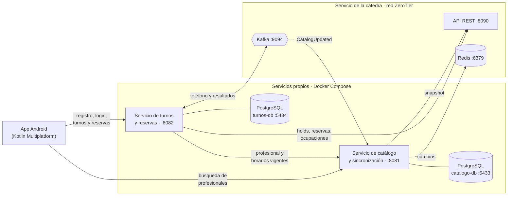

# turnos-catalogo-service

Servicio de catálogo y sincronización del proyecto integrador 2026 de Programación II. Mantiene una réplica local del catálogo de la cátedra (categorías, profesionales y horarios semanales) mediante snapshot, Redis y Kafka, y resuelve la búsqueda de profesionales utilizando exclusivamente datos locales.

## Arquitectura

La solución está compuesta por una aplicación Android desarrollada con Kotlin Multiplatform y dos servicios backend independientes en Java y Spring Boot, cada uno con su propia base de datos PostgreSQL. Ambos servicios se integran con el servicio central de la cátedra mediante REST, Redis y Kafka.



| Componente | Responsabilidad |
|---|---|
| App Android (KMP) | Registro, inicio de sesión, búsqueda de profesionales y gestión de reservas propias |
| Servicio de catálogo | Copia local del catálogo, sincronización completa e incremental y búsqueda de profesionales |
| Servicio de turnos | Usuarios y JWT, disponibilidad, proceso de reserva, consulta y cancelación |
| Servicio de la cátedra | Fuente autoritativa del catálogo, holds y reservas |

Cada servicio es propietario exclusivo de su base de datos y administra sus propias migraciones. La comunicación entre los servicios propios y desde la aplicación se protege con JWT; el acceso al servicio de la cátedra utiliza el JWT técnico del proyecto, que nunca se expone a la aplicación.

## Tecnologías

- Java 21 y Spring Boot
- PostgreSQL 17 (Docker Compose)
- Flyway para migraciones de base de datos
- Arquitectura hexagonal (puertos y adaptadores)

## Requisitos

- JDK 21
- Docker Desktop
- Acceso a la red ZeroTier de la cátedra (para la integración con REST, Redis y Kafka)

## Cómo ejecutar

1. Copiar `.env.example` como `.env` y completar los valores (contraseña de la base y credenciales de la cuenta técnica).
2. Levantar la base de datos:
```bash
   docker compose up -d
```
3. Iniciar el servicio:
```bash
   ./mvnw spring-boot:run
```
Flyway crea el esquema automáticamente al iniciar. El servicio queda disponible en el puerto `8081`.

## Documentación

- [Integración con el servicio de la cátedra](docs/integracion_catedra.md)